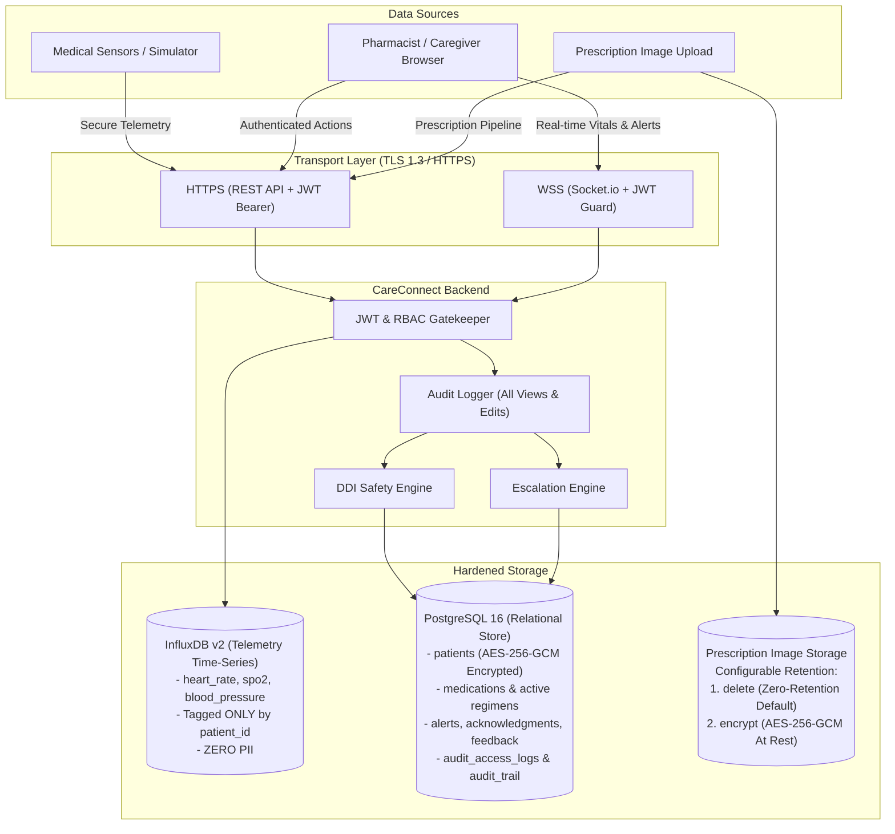

# CareConnect Privacy & Data Protection Architecture

> [!IMPORTANT]
> **Regulatory Notice & Medical Privacy Standard**
> CareConnect is engineered to conform with health data protection standards (including HIPAA and GDPR health data directives). It adheres strictly to the **Data Minimization Principle**: personally identifiable information (PII) and protected health information (PHI) are kept strictly separate from high-frequency biometric streams, encrypted at rest, and redacted from all system telemetry and diagnostic logs.

---

## 1. End-to-End Data Flow Architecture

The following diagram illustrates how telemetry, patient records, and prescription data traverse CareConnect's hardened boundary:



---

## 2. Storage Separation Matrix

CareConnect enforces strict physical and architectural separation between continuous high-frequency telemetry and clinical identification records:

| Data Class | Storage Engine | Fields Stored | Encryption & Anonymization Status |
|---|---|---|---|
| **Vital Signs Telemetry** | **InfluxDB v2** (`vitals` bucket) | `heart_rate`, `spo2`, `systolic_bp`, `diastolic_bp`, `timestamp` | **Anonymized**: Tagged exclusively by opaque `patient_id` (e.g. `pt_001`). No patient names, birth dates, or addresses are stored. |
| **Patient Demographics (PHI)** | **PostgreSQL** (`patients` table) | `name`, `phone`, `primary_caregiver_phone`, `secondary_contact_phone` | **Encrypted at Rest**: AES-256-GCM field-level encryption with dedicated 96-bit IV and 128-bit authentication tag. |
| **Active Medications** | **PostgreSQL** (`medications` table) | Drug name, generic name, strength, frequency, RxNorm ID, safety notes | Normalized against NIH RxNorm. Linked to `patient_id`. |
| **Alerts & Feedback** | **PostgreSQL** (`alerts` table) | Severity (`GREEN`, `YELLOW`, `RED`), type, hemodynamic notes, clinical feedback | Stored with full audit timestamps for clinical quality review. |
| **Prescription Images** | **Prescription Storage** | Raw scanned or photographed prescription documents | **Configurable**: Immediately deleted or encrypted at rest (`.enc`). |
| **Audit Logs** | **PostgreSQL** (`audit_access_logs`) | Actor, role, resource, action, patient ID, timestamp | Immutable append-only log of every view or modification. |

---

## 3. Cryptographic Controls & Encryption Standards

### 3.1 Encryption in Transit (HTTPS / TLS 1.3)
- In production, CareConnect mandates HTTPS (`TLS_ECDHE_RSA_WITH_AES_256_GCM_SHA384` or higher).
- The backend natively supports SSL certificate mounting via `SSL_KEY_PATH` and `SSL_CERT_PATH`.
- WebSocket connections (Socket.io) require WSS and pass through the JWT verification handshake.

### 3.2 Field-Level Encryption at Rest (AES-256-GCM)
All sensitive demographic columns in PostgreSQL are encrypted prior to insertion using AES-256-GCM:
- Format: `enc:v1:<iv_hex>:<authTag_hex>:<ciphertext_hex>`
- Key derivation: 256-bit key loaded from `ENCRYPTION_KEY` using SHA-256 digest.
- Authenticated decryption validates the cryptographic auth tag on read, preventing undetected database tampering.

---

## 4. Uploaded Prescription Image Retention Policy

CareConnect provides a configurable image retention setting via the `PRESCRIPTION_IMAGE_RETENTION` environment variable:

```env
# Supported values: "delete" (recommended) or "encrypt"
PRESCRIPTION_IMAGE_RETENTION=delete
```

### Mode A: `delete` (Zero-Retention Privacy Default - Recommended)
1. **Pipeline Execution**: The uploaded prescription image is processed in volatile memory.
2. **Immediate Purge**: Once the layout analysis segments the document and extracts cropped medication lines, the raw uploaded prescription file and original image buffer are **completely deleted and wiped from storage**.
3. **Privacy Benefit**: Eliminates the risk of physical image exfiltration, patient address exposure, doctor signature theft, or document leakage.
4. **Pharmacist Verification**: Pharmacists in the review queue view only the localized, isolated cropped medication lines necessary to confirm drug name and dosage.

### Mode B: `encrypt` (Encrypted Archive for Regulatory Compliance)
1. **Use Case**: Required by institutions subject to legal mandates demanding original prescription archiving.
2. **AES-256-GCM Storage**: The raw image is encrypted at rest with a random 96-bit nonce and stored in `prescription/storage/encrypted/<prescription_id>.enc`.
3. **Restricted Access**: Decryption is permitted solely through authenticated endpoints with verified `pharmacist` or `admin` credentials.

---

## 5. PII Redaction & Diagnostic Logging Rule

> [!CAUTION]
> **Zero PII Logging Mandate**
> Application logs, container output, and error traces **must never contain patient names, raw phone numbers, or unmasked identifiers**.

1. **System Logging Rule**: All `console.log`, `console.error`, and Python `logger.info` calls are strictly restricted to:
   - Synthetic identifiers (`patient_id="pt_001"`, `alert_id="evt_abc123"`)
   - Clinical event counts and non-identifying telemetry metrics.
2. **Masking Utilities**:
   - Phone numbers are masked: `+1-555-***-0101`
   - Patient names are masked: `E*** V***`

---

## 6. Access Control & Role-Based Permissions (RBAC)

CareConnect enforces 4 distinct operational roles using JSON Web Tokens (JWT):

| Role | Permissions | Access Scope |
|---|---|---|
| `caregiver` | View assigned patient vitals, receive escalation alerts, acknowledge alerts, submit "False alarm" / "Real problem" feedback. | Assigned `patient_ids` only. |
| `secondary_contact` | Receive escalated emergency notifications when primary caregiver does not respond within 60 seconds; view emergency vitals. | Assigned `patient_ids` only. |
| `pharmacist` | View prescription review queue, inspect parsed medication drafts, approve/edit extracted prescriptions, inspect drug interactions. | All prescription and medication records. |
| `admin` | Full administrative access: trigger migrations, database seeding, audit trail inspection, system health configuration. | Global system access. |

---

## 7. Audit Logging (Access & Action Trail)

Every interaction with patient data generates an immutable audit record stored in `audit_access_logs`:
- **Data Views**: Every request to `GET /api/patients/:id`, `GET /api/medications/:id`, `GET /api/vitals/:id`.
- **Data Edits**: Every update to medications, prescription approvals, or patient profile changes.
- **Alert Actions**: Every alert dispatch, acknowledgment, escalation step, and feedback submission.
- **Audit Verification**: Queried via `GET /api/audit` or `GET /api/alerts/:id/audit`.
