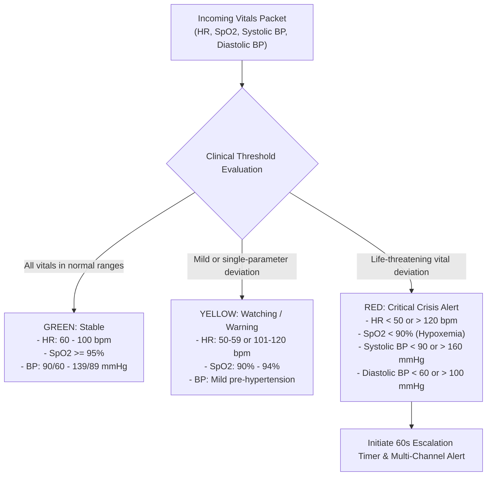
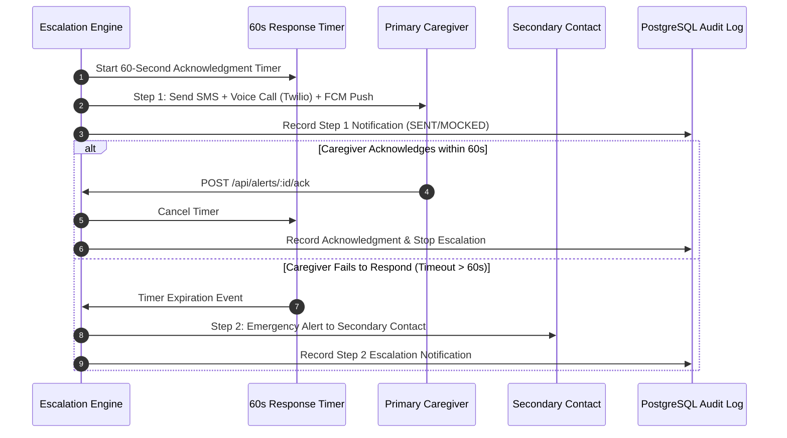
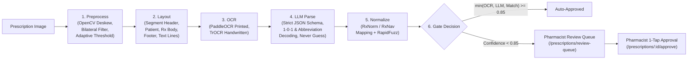

# CareConnect Clinical Safety & Decision Support Architecture

> [!WARNING]
> ### MANDATORY CLINICAL DISCLAIMER
> **Decision support only. Consult a pharmacist or doctor. Not a diagnostic tool.**
>
> CareConnect is an assistive Clinical Decision Support System (CDSS) intended to alert caregivers and healthcare providers to physiological anomalies and high-risk pharmacological interactions. **It does not generate autonomous medical diagnoses, modify prescription dosages, or substitute for the professional clinical judgment of a licensed physician or pharmacist.**

---

## 1. Safety Principles & System Boundaries

CareConnect is designed around four fundamental safety pillars:
1. **Human-in-the-Loop**: High-consequence decisions (such as prescription onboarding and medication reconciliation) always require licensed pharmacist review.
2. **Deterministic Thresholding for Criticality**: Critical alerts are generated using established physiological thresholds and evidence-based pharmacodynamic interaction databases—never unconstrained generative models.
3. **Escalation Redundancy**: If a primary caregiver does not acknowledge a critical life-safety alert within 60 seconds, the system automatically escalates to a secondary contact across multiple communication channels (SMS, Voice call, Push).
4. **Graceful Fallback & Fail-Safe Defaults**: When external services (Twilio, Firebase, PostgreSQL, InfluxDB) are unreachable, the system fails open to redundant in-memory queues and offline notification stubs to ensure uninterrupted patient safety monitoring.

---

## 2. Multi-Tier Vital Signs Evaluation

Continuous physiological streams are processed through deterministic bounding rules:



---

## 3. Drug-Drug Interaction (DDI) Safety Engine

CareConnect evaluates active medication regimens to prevent adverse drug events (ADEs), drug-induced hemodynamic crashes, and severe contraindications.

### 3.1 Combinatorial Pair Generation
For a patient prescribed $n$ active medications, the engine computes all unique pairwise combinations:
$$\text{Total Pairs} = \frac{n(n - 1)}{2}$$
Every pair is evaluated against the curated interaction matrix (`backend/data/interactions.json`) of 27 high-priority critical rules.

### 3.2 Curated Critical Interaction Classes
| Drug Pair / Class | Severity | Mechanism | Affected Vitals / Clinical Danger |
|---|---|---|---|
| **Warfarin + Ibuprofen (NSAID)** | `CRITICAL` | Additive antiplatelet inhibition and gastric mucosa erosion. | Bleeding risk, hemorrhage, GI bleeding. |
| **Lisinopril (ACEi) + Spironolactone** | `CRITICAL` | Additive potassium retention. | Arrhythmia, hyperkalemia, cardiac arrest. |
| **Sildenafil + Nitroglycerin** | `CRITICAL` | Severe synergistic cGMP-mediated vasodilation. | Profound hypotensive shock (low blood pressure). |
| **Sertraline (SSRI) + Tramadol** | `CRITICAL` | Dual serotonin reuptake inhibition and excess 5-HT. | Serotonin syndrome, tachycardia, hyperthermia. |
| **Metoprolol + Lisinopril** | `CRITICAL` | Dual negative chronotropy and vasodilation. | Severe bradycardia, profound hypotension. |

### 3.3 Alert Suppression & Unknown Medication Safety Protocol
- **Only `CRITICAL` interactions trigger `RED COMPOUND` alerts** that activate caregiver escalation.
- `MODERATE` and `MINOR` interactions are silently recorded in the patient chart for clinician review during routine consults, preventing **alert fatigue**.
- **Unverified Medications**: If a patient is prescribed an unrecognized or non-RxNorm mapped drug, the system flags:
  `"Unverified Medication - Manual Review Required"`
  The run completes safely without crashing, alerting clinicians to verify the medication manually.

---

## 4. Emergency Escalation Protocol & Redundancy



### 4.1 Anti-Fatigue Rate Limiting
To prevent notification storms during sustained patient distress, CareConnect enforces a rate limit:
- **Maximum 1 automated notification per patient per alert type per 5 minutes**.
- Subsequent vital updates continue to update dashboards and database audit trails in real time without spamming phone channels.

---

## 5. Pharmacist-in-the-Loop Prescription Pipeline

The prescription processing pipeline extracts medications from uploaded prescription images through 6 independent validation stages:



### 5.1 Strict Gating Metric
$$\text{Overall Confidence} = \min(\text{Confidence}_{\text{OCR}},\, \text{Confidence}_{\text{LLM}},\, \text{Confidence}_{\text{Match}})$$
- **$\ge 0.85$**: Meets automated confidence criteria.
- **$< 0.85$**: Immediately held in the review queue. Pharmacists must verify or edit the draft before medications can become active on the patient profile.

---

## 6. Verification & Audit Trail Summary

Every alert dispatched, caregiver call placed, vital deviation detected, and prescription approved is logged in PostgreSQL with immutable timestamps. Clinicians and regulatory auditors can retrieve the full chronological timeline using:

```http
GET /api/alerts/:event_id/audit
GET /api/audit?patient_id=pt_001
```

> **Safety Assurance**: The audit log proves exactly which caregiver was notified, the exact vitals at the moment of escalation, and the pharmacist who verified every medication.
