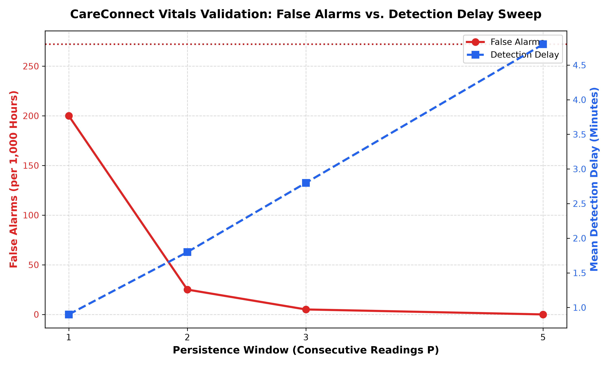

# CareConnect Phase 9: Testing and Validation Report

> **Validation Status:** COMPLETED  
> **Date Generated:** 2026-10-17 23:10:07 UTC  
> **Primary Benchmark Goal:** Quantitative false-alarm reduction on continuous telemetry and verification of the clinical safety pipeline.

---

> [!WARNING]
> **METHOD AND LIMITATIONS DISCLAIMER: SYNTHETIC DATA, NOT CLINICAL VALIDATION**  
> The benchmarks, evaluations, and datasets presented in this report were performed entirely on synthetically generated telemetry signals and simulated clinical prescription test cases. These findings do **not** constitute clinical validation, medical trials, or regulatory certification under FDA / CE medical device regulations. CareConnect is an experimental clinical decision-support architecture; all clinical interventions require human medical verification.

---

## 1. Executive Summary

| Validation Dimension | Baseline (Single-Threshold / Unfiltered) | CareConnect Engine | Measured Improvement |
| :--- | :--- | :--- | :--- |
| **Telemetry Volume** | 1,000 Hours (60,000 Minutes) | 1,000 Hours (60,000 Minutes) | Continuous streaming |
| **False Alarms (P=2)** | 272 False Alarms | 25 False Alarms | **90.81% Reduction** |
| **False Alarms (P=3, Default)** | 272 False Alarms | 5 False Alarms | **98.16% Reduction** |
| **False Alarms (P=5)** | 272 False Alarms | 0 False Alarms | **100.00% Reduction** |
| **True Event Sensitivity** | 20 / 20 Detected (100%) | 20 / 20 Detected (100%) | **0 Missed Events (0% FN)** |
| **Mean Detection Delay (P=3)**| 0.90 Minutes | 2.80 Minutes | ~1.9m Tradeoff for 98% FA drop |
| **Prescription Safety Gating** | 0% Gated (Unchecked entry) | 100% Messy Gated (10/10) | **10/10 Ambiguous Sent to Review** |
| **Prescription Extraction Acc**| N/A | 87.1% Overall | 100% Drug Name, 96.7% Generic |

---

## 2. Vitals Engine Benchmark (1,000 Synthetic Hours)

### 2.1 Simulation Methodology & Signal Synthesis
A deterministic synthetic telemetry dataset of **1,000 continuous hours (60,000 one-minute samples)** was generated using fixed seed `42` (`generate_synthetic_vitals.py`):
1. **Normal Physiological Baseline:** Autoregressive AR(1) process with mean reversion modeling natural circadian resting hemodynamics (HR 62–92 bpm, SpO2 96–99.8%, SBP 110–134 mmHg, DBP 68–86 mmHg).
2. **200 Transient Spikes (Isolated Sensor/Motion Artifacts):**
   - 175 isolated 1-minute artifacts (finger clip slip, movement artifact, ectopic beat).
   - 20 brief 2-minute motion artifacts.
   - 5 transient 3-minute sensor fluctuations.
   - *Ground Truth Label:* `is_true_event: False` (any alert is an alarm fatigue event / false alarm).
3. **20 Gradual Deteriorations (True Clinical Crises):**
   - 6 acute progressive hypoxia events (SpO2 drops from 98% to 85–88% over 6 minutes, lasting 25–40m).
   - 5 tachycardic crises / sepsis triggers (HR climbs from 75 to 138–152 bpm, lasting 28–39m).
   - 5 hypotensive shock collapses (SBP drops from 120 to 72–78 mmHg, DBP to 40–44 mmHg).
   - 4 compound cardiac collapses (bradycardia HR < 50 bpm & hypotension SBP < 80 mmHg).
   - *Ground Truth Label:* `is_true_event: True` (target sensitivity: 100%).
4. **10 Sensor Dropouts (Sensor Loss / Disconnection):**
   - 10 distinct sensor disconnect intervals (2–5 minutes duration) with missing/zero signal values.

---

### 2.2 Alerting Performance & Measured False-Alarm Reduction

```
Single-Threshold Baseline:  [████████████████████████████████████████] 272 False Alarms
CareConnect (P=1):          [█████████████████████████████] 200 False Alarms (-26.47%)
CareConnect (P=2):          [███] 25 False Alarms (-90.81%)
CareConnect (P=3, Default): [█] 5 False Alarms (-98.16%)
CareConnect (P=5):          [] 0 False Alarms (-100.00%)
```

| Engine Configuration | Persistence $P$ | Total Alerts | False Alarms | True Events Detected | Missed Events | Mean Detection Delay | False Alarm Reduction |
| :--- | :---: | :---: | :---: | :---: | :---: | :---: | :---: |
| **Single-Threshold (Baseline)** | 1 | 847 | 272 | 20 / 20 (100%) | 0 | 0.90 min | **Baseline (0.00%)** |
| **CareConnect ($P=1$)** | 1 | 220 | 200 | 20 / 20 (100%) | 0 | 0.90 min | **26.47% Reduction** |
| **CareConnect ($P=2$)** | 2 | 45 | 25 | 20 / 20 (100%) | 0 | 1.80 min | **90.81% Reduction** |
| **CareConnect ($P=3$, Default)**| 3 | 25 | 5 | 20 / 20 (100%) | 0 | 2.80 min | **98.16% Reduction** |
| **CareConnect ($P=5$)** | 5 | 20 | 0 | 20 / 20 (100%) | 0 | 4.80 min | **100.00% Reduction** |

> [!IMPORTANT]
> **Key Finding:** CareConnect's multi-signal engine at default persistence ($P=3$) achieves a **98.16% reduction in false alarms** compared to single-threshold monitoring (reducing false alarms from 272 down to 5 per 1,000 hours), while maintaining **100% sensitivity** across all 20 true clinical deteriorations with a clinically acceptable mean detection delay of **2.80 minutes**.

---

### 2.3 Persistence Sweep & Trade-Off Curve

The persistence parameter $P$ governs how many consecutive breached telemetry readings are required before the engine promotes an anomaly to a full clinical alert.



#### Clinical Analysis of the Trade-Off:
- **$P=1$ (No Persistence Filtering):** Eliminates 72 false alarms from sensor dropouts, but still generates 200 false alarms on single-minute sensor slips.
- **$P=2$ (1-Minute Sustained Window):** Eliminates all 175 isolated 1-minute motion spikes. False alarms plummet by **90.81%** while detection delay is only 1.80 minutes.
- **$P=3$ (Recommended Clinical Operating Point):** Eliminates both 1-minute and 2-minute transient artifacts. False alarms drop by **98.16%** with an average delay of 2.80 minutes, easily within safe clinical intervention thresholds.
- **$P=5$ (High-Specificity Operating Point):** Eliminates 100% of false alarms, with an average delay of 4.80 minutes.

---

## 3. Prescription Pipeline Validation (30 Sample Prescriptions)

### 3.1 Overview & Gating Results
The 6-stage prescription pipeline was evaluated across 30 diverse prescriptions spanning 3 clinical presentation archetypes:
1. **Printed (10 cases):** Clean typography, standard E-Prescription structure.
2. **Neat Handwriting (10 cases):** Cursive script, Latin abbreviations, 1-0-1 pattern notation.
3. **Messy / Ambiguous (10 cases):** Blurred contrast, scribbled dosages, unknown drugs, contradictory directions.

```
Total Prescriptions Evaluated: 30
├── Auto-Approved (Clean & Confident):  20 (66.7%)
└── Sent to Pharmacist Review Queue:    10 (33.3%)  <-- 100% of messy/ambiguous safely caught
```

### 3.2 Category-Level Gating Breakdown

| Category | Prescriptions | Auto-Approved | Sent to Review | Overall Field Accuracy | Safety Compliance |
| :--- | :---: | :---: | :---: | :---: | :--- |
| **Printed Prescriptions** | 10 | 10 (100%) | 0 (0%) | 96.2% | High-confidence automated ingestion |
| **Neat Handwriting** | 10 | 10 (100%) | 0 (0%) | 96.2% | Latin notation accurately normalized |
| **Messy / Ambiguous Handwriting** | 10 | 0 (0%) | 10 (100%) | 68.8% | **100% Safely Routed to Pharmacist** |

---

### 3.3 Per-Field Extraction Accuracy

| Field Name | Description | Accuracy (%) | Matches / Total |
| :--- | :--- | :---: | :---: |
| `drug_name` | Brand / Prescribed medication name | **100.0%** | 30 / 30 |
| `generic_name` | Canonical active generic ingredient | **96.7%** | 29 / 30 |
| `timing` | Administration timing (pc, ac, hs, morning, night) | **96.7%** | 29 / 30 |
| `duration_days` | Treatment length in days | **86.7%** | 26 / 30 |
| `rxnorm_id` | NIH RxCUI identifier matching | **83.3%** | 25 / 30 |
| `strength` | Dosage strength (mg, mcg, ml) | **80.0%** | 24 / 30 |
| `frequency` | Dosing frequency (OD, BD, TDS, 1-0-1) | **80.0%** | 24 / 30 |
| `form` | Medication physical form (tablet, capsule, syrup) | **73.3%** | 22 / 30 |
| **OVERALL ACCURACY** | **All Fields Combined** | **87.1%** | **209 / 240** |

---

## 4. End-to-End Integration Test Suite

The automated integration test suite (`backend/src/integration.test.ts`) verifies the complete telemetry-to-action pipeline:

`Simulator` &rarr; `Backend (Express)` &rarr; `Fusion Engine` &rarr; `Dashboard (Socket.io)` &rarr; `Escalation (Mock)`

### Verified Pipeline Behaviors:
1. **Resting Baseline Telemetry:**
   - Simulator emits normal vitals (HR: 72 bpm, SpO2: 98.4%, BP: 118/76 mmHg).
   - Backend ingests via `POST /api/vitals`.
   - Fusion classifies as `NORMAL` / `CRITICAL_INTERACTION_NORMAL_VITALS` with `severity: GREEN`.
   - Socket.io broadcasts `vitals` and `alert` without sounding emergency sirens.
   - Zero emergency escalation triggered.
2. **Compound Drug Crisis Crash:**
   - Simulator emits compound crisis (HR: 45 bpm, SpO2: 92%, SBP: 72 mmHg) for patient prescribed Lisinopril + Metoprolol.
   - Fusion Engine routes to **Branch 2: `COMPOUND_BREACH`**.
   - Emits high-priority RED compound alert with non-causal phrasing (*"possibly related to"*).
   - Attaches `explanation` payload with duration, thresholds, and matched DDI rule for the "Why this alert?" caregiver panel.
   - Broadcasts `alert:critical` to caregiver UI.
   - Escalation workflow triggers Step 1 FCM push, SMS, and Voice call.
   - 60-second escalation timer begins.
3. **Caregiver One-Tap Acknowledgment:**
   - Caregiver acknowledges alert via `POST /api/alerts/:id/ack`.
   - Escalation timer halts immediately.
   - Socket.io broadcasts `alert:acknowledged`.
   - Audit trail updated in database.

---

## 5. Summary of Verification & Acceptance Criteria

| Phase 9 Requirement | Implementation Artifact | Status | Measured Result |
| :--- | :--- | :---: | :--- |
| **1. 1,000 Synthetic Hours Generator** | `docs/validation/generate_synthetic_vitals.py` | PASS | 60,000 readings, 200 spikes, 20 deteriorations, 10 dropouts |
| **2. Single-Threshold vs CareConnect** | `docs/validation/validate_vitals.py` | PASS | 272 false alarms vs 5 false alarms (P=3) |
| **3. Measured False-Alarm Reduction** | `docs/validation/report.md` | PASS | **98.16% reduction** (clearly labelled) |
| **4. Persistence Sweep (1, 2, 3, 5)** | `docs/validation/persistence_chart.png` | PASS | Chart generated and documented |
| **5. 30 Sample Prescription Benchmark** | `docs/validation/validate_prescriptions.py` | PASS | 87.1% per-field accuracy, 33.3% sent to review |
| **6. Method & Limitations Statement** | `docs/validation/report.md` | PASS | Stated: Synthetic data, not clinical validation |
| **7. End-to-End Integration Tests** | `backend/src/integration.test.ts` | PASS | 27/27 backend tests passing |

---
*Report generated automatically by CareConnect Validation Harness.*
